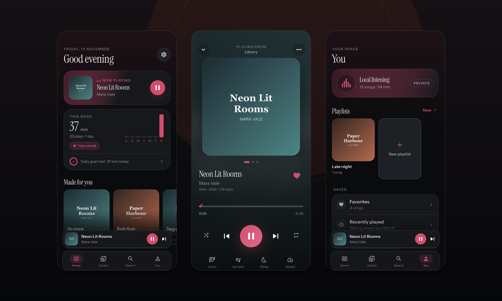

<p align="center">
  <picture>
    <source media="(prefers-color-scheme: dark)" srcset="docs/images/logo-dark.png">
    
  </picture>
</p>

<p align="center">
  An offline music player for the songs you already own.
</p>

<p align="center">
  <a href="https://github.com/shovoghosh/Timbre/releases"></a>
  
  
  
</p>

<p align="center">
  
</p>

Timbre plays the music that is already on your phone. Point it at your folders
and it builds a library from the tags and cover art inside your files. Nothing
is uploaded. There is no account, no ads, and no subscription.

It is an original app: its own name, icon, design, and code, with no borrowed
screens or assets.

## Download

Install `Timbre-1.0.0.apk` from the
[Releases page](https://github.com/shovoghosh/Timbre/releases) on any Android
phone running 7.0 or newer. Android may ask you to allow installs from this
source the first time.

iPhone builds need Xcode on a Mac, since Apple does not allow installing an app
from a file.

## What you get

- **A library that stays local.** Scans the folders you allow, reads embedded
  tags and artwork, and never copies a file without asking.
- **A home that knows you.** Pick up where you left off, your week with a goal
  ring, mixes built from what you actually play, and recently added albums.
- **Three player skins.** Sleeve, Vinyl, and Spectrum, plus a queue you can
  reorder.
- **Listening stats and a recap.** Minutes, streaks, top artists and albums, your
  busiest hour, and a weekly story you can share.
- **Real device sound.** An Android equalizer with the phone's own presets and
  bass boost, not a fake bar graphic.
- **Your setup travels.** Back up playlists, favorites, ratings, lyrics, and
  history to one file, without ever including your music.

## Features

### Library

- Android MediaStore scan with tags, duration, bitrate, and cover art.
- Songs, Albums, Artists, and Folders, each with its own view.
- Search across titles, artists, albums, and folders.
- Sort by recently added, title, artist, album, longest, or year.
- Hide short clips, and block any folder you would rather not see.
- Fills missing tags from the file itself for formats the system cannot read,
  including WAV.

### Playing

- Background playback with a media notification, lock screen controls, and
  headset buttons.
- Queue with drag to reorder, shuffle, and repeat off, all, or one.
- Per song playback speed, remembered between sessions.
- Crossfade as a soft fade out and in, plus a sleep timer that fades to silence.
- Lyrics from an LRC file or your own text, shown full screen.

### Your music

- Playlists with covers, and favorites, ratings, recently played, on repeat, and
  fresh finds.
- Listening history that powers the stats and the weekly recap.
- Share cards for the recap, rendered in the app and saved as images.

### Look and sound

- Auto, light, dark, and black themes, with eight accents and an accent that can
  follow the current cover.
- Frosted bars, editorial type, and motion that settles quickly.
- The Android equalizer, with presets from the device and bass boost where the
  phone allows it.

### Private by default

Everything stays on the phone. Timbre goes online only when you open **Change
cover** and search for artwork, and then it sends the words in the search box to
the public iTunes and Deezer search APIs. There is no analytics and no ad SDK.
Read [docs/PRIVACY.md](docs/PRIVACY.md) for the full policy.

## Design

Timbre should feel like a small printed music magazine that happens to play
files. Instrument Serif for titles, Instrument Sans for everything else, near
black ink on warm paper, one accent at a time, hairlines instead of boxes. All
fonts are bundled, so the app works offline.

The eight accents are Ember, Amber, Olive, Tide, Cobalt, Iris, Rose, and Sand.
Ember is the default.

## Build from source

You need Flutter 3.47 or newer, and Android SDK 37 for Android builds.

```bash
flutter pub get
flutter run
flutter test
flutter build appbundle --release   # Play Store
flutter build ipa --release         # App Store, on macOS
```

Android release signing is read from `android/key.properties`. Copy
`android/key.properties.example` and point it at your keystore. Without that
file, release builds fall back to debug keys so local builds still work. Never
upload a debug signed build to a store.

```bash
keytool -genkey -v -keystore timbre-release.jks -keyalg RSA -keysize 2048 \
  -validity 10000 -alias timbre
```

For iOS, open `ios/Runner.xcworkspace`, set your team and bundle identifier, then
archive. The full publishing checklist lives in [docs/STORE.md](docs/STORE.md).

## Project layout

```
lib/
  app.dart                 root widget and theme wiring
  core/                    prefs, services, formatting, haptics
  theme/                   color tokens, type scale, theme controller
  data/
    models/                track, playlist, play event
    library/               scan, tags, artwork, import, stores, cover search
    history/               plays database and stats
    settings/              app settings and backup
  audio/                   playback controller and device effects
  ui/
    shell/                 tabs, bottom nav, mini player
    pages/                 home, library, search, you, player, pages
    player/                skins, scrubber, queue, lyrics, timers
    widgets/               shared pieces
android/                   Kotlin MediaStore and audio effects channels
ios/                       Runner, background audio, file sharing
test/                      unit tests for stats, lyrics, tags, formatting
scripts/                   demo audio, brand, store and README assets
docs/                      privacy, store checklist, design notes
```

## Known limits

- The equalizer is Android only. iPhone does not let apps change the system
  equalizer, and the page says so.
- Crossfade is a soft fade out and in between songs, not an overlap.
- Home screen widgets are planned, not shipped.

## License

Timbre is released under the [Timbre License 1.0](LICENSE). It is free to use
and to share with people you know. Changing it, republishing it, or putting it on
a store needs written permission from the author.

The app code and brand are original work. Bundled fonts, Instrument Serif and
Instrument Sans, are used under the SIL Open Font License, with the license files
in `assets/fonts/`. Third party package licenses are available in the app under
You, About, Licenses.

## Changes

See [CHANGELOG.md](CHANGELOG.md) for what shipped in each release.
